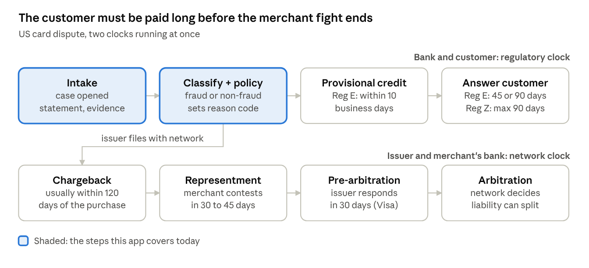

# Dispute Management Case Study: JUNO vs IBM ACM & Real Bank Operations

Oct 13, 2026 · Nawin Viswajith

## Summary

This project automates the first, internal half of a bank's dispute process: classifying the claim, citing a policy, recommending an action and scoring evidence. Enterprise systems such as IBM Advanced Case Management cover the whole case lifecycle with roles, content, rules and audit, but leave the judgment to rules that analysts write. The two are complementary: AI agents could act as the decision layer on top of case management.

- **The stakes are rising.** Mastercard projects chargebacks growing from 261 million ($33.8 billion) in 2025 to 324 million ($41.7 billion) in 2028; each dispute costs a bank roughly $9–$10 to process.
- **The hard part is the clock.** US rules require provisional credit within 10 business days, while the network cycle with the merchant runs 45–180 days, so banks front money they may not recover.
- **Automation can create liability.** Regulators fined Bank of America $225 million partly for replacing investigations with an automated fraud filter, and Block $175 million for incomplete investigations.
- **Top fixes for this app.** Make the document agent read the documents, add regulatory deadline and provisional-credit tracking, and model the network stages (chargeback, representment, arbitration).

## The dispute process, end to end

A card dispute runs on two clocks at once: the regulator's clock between the bank and its customer, and the card network's clock between the issuing bank and the merchant's bank (the acquirer). Most of a bank's cost and risk sits in the gap between them. End to end, a dispute typically takes 45–90 days, and 120–180 days if it reaches arbitration ([Lithic](https://docs.lithic.com/docs/dispute-lifecycle)).

1. **Intake.** The customer reports the problem by phone, app or branch. The bank captures the transaction, the reason and the customer's statement. In IBM's reference scenario, an IVR identifies the caller, a service rep opens a case, and the call recording is attached to the case automatically ([IBM](https://ibm.com/docs/en/SS8JB4_20.x/com.ibm.wbpm.workflow.main.doc/topics/acmov002.html)).
2. **Triage and classification.** The bank decides whether this is fraud ("I didn't make this") or a non-fraud dispute (not received, not as described, cancelled subscription, duplicate, wrong amount). That choice sets the network reason code and, at Visa, the workflow: **Allocation** for fraud and authorization disputes, where Visa runs automated validity checks and assigns liability up front, or **Collaboration** for processing errors and consumer disputes, which works like a classic chargeback ([Qualpay](https://help.qualpay.com/help/visa-claims-resolution-whats-changing)).
3. **Provisional credit and the regulatory clock.** For debit and other electronic transfers in the US, Regulation E gives the bank 10 business days to investigate. It can take up to 45 days (90 for point-of-sale, foreign or new-account cases) only if it provisionally credits the customer within those 10 business days ([12 CFR 1005.11](https://www.law.cornell.edu/cfr/text/12/1005.11)). For credit cards, Regulation Z requires a written acknowledgment within 30 days and resolution within two billing cycles, never more than 90 days; meanwhile the bank may not collect the disputed amount or report it as delinquent ([12 CFR 1026.13](https://www.law.cornell.edu/cfr/text/12/1026.13)).
4. **Chargeback.** The issuer files with the network, typically within 120 days of the transaction. Liability formally moves to the acquirer and funds move for the first time ([Lithic](https://docs.lithic.com/docs/dispute-lifecycle)).
5. **Representment.** The merchant, through its acquirer, contests with evidence such as a delivery receipt or device and IP history. Acquirers usually have 30–45 days. If it succeeds, liability and the funds swing back to the issuer.
6. **Pre-arbitration.** The issuer accepts the loss or pushes back with more evidence. At Visa, the issuing bank then has 30 days to respond, in both the Allocation and Collaboration workflows ([Qualpay](https://help.qualpay.com/help/visa-claims-resolution-whats-changing)).
7. **Arbitration.** The network rules, for a fee, and can split liability between both sides ([Lithic](https://docs.lithic.com/docs/dispute-lifecycle)).

*Card dispute lifecycle · regulatory and network clocks*

The top row must finish within weeks; the bottom row can run for months. If the bank loses on the bottom row and cannot re-debit the customer, the provisional credit becomes its loss.

| Rule | Applies to | Bank's deadline |
| --- | --- | --- |
| [Reg E 1005.11](https://www.law.cornell.edu/cfr/text/12/1005.11) | US debit / electronic transfers | Investigate in 10 business days, or provisionally credit within 10 and finish in 45 (90 for POS, foreign, new accounts); report results within 3 business days |
| [Reg Z 1026.13](https://www.law.cornell.edu/cfr/text/12/1026.13) | US credit cards | Acknowledge in 30 days; resolve within 2 billing cycles, max 90 days |
| Card network filing | Issuer to network | Usually within 120 days of the transaction |
| [Visa pre-arbitration](https://help.qualpay.com/help/visa-claims-resolution-whats-changing) | Issuer response | 30 days in both workflows |

The gap that hurts: the regulator expects the customer to be made whole within about 10 business days, while the merchant has 30 days or more to fight back. The bank therefore fronts the money and carries the loss if it later loses representment and cannot recover the credit from the customer.

## How IBM Advanced Case Management handles disputes

IBM ACM is a platform, not a ready-made dispute product: the bank models disputes as a case type, and the platform supplies the case folder, workflow, documents, rules, roles and analytics around it. IBM's own reference solution for this is a credit card dispute scenario in IBM Business Automation Workflow, the current home of IBM Case Manager ([IBM scenario](https://ibm.com/docs/en/SS8JB4_20.x/com.ibm.wbpm.workflow.main.doc/topics/acmov002.html)).

| Building block | What it does in a dispute system |
| --- | --- |
| Solution and case types | "Solutions consist of case types, tasks, steps, and other components"; a dispute is one case that holds everything about that claim ([IBM overview](https://www.ibm.com/docs/SSCTJ4_5.3.2/com.ibm.casemgmt.installing.doc/acmov000.htm)) |
| Tasks | Automatic tasks run every time (register, process, pay, close); discretionary tasks are added when needed (support request, escalate, legal request, reopen) ([IBM Redbook](https://www.redbooks.ibm.com/abstracts/tips1146.html)) |
| Roles | Separate work queues and permissions for intake staff, processors, supervisors, legal and accounting ([IBM Redbook](https://www.redbooks.ibm.com/abstracts/tips1146.html)) |
| Content | Document storage with metadata, versioning, security and records management, built on FileNet ([IBM overview](https://www.ibm.com/docs/SSCTJ4_5.3.2/com.ibm.casemgmt.installing.doc/acmov000.htm)) |
| Events and rules | "The addition of a document or a field change triggers a case task"; business rules route and decide ([IBM overview](https://www.ibm.com/docs/SSCTJ4_5.3.2/com.ibm.casemgmt.installing.doc/acmov000.htm)) |
| Analytics | Case Analyzer and Case Monitor dashboards for supervisors ([IBM overview](https://www.ibm.com/docs/SSCTJ4_5.3.2/com.ibm.casemgmt.installing.doc/acmov000.htm)) |
| Builder and client | Case Builder lets business analysts design the case model; Case Client is the worker's screen, both on IBM Content Navigator ([IBM Redbook](https://www.redbooks.ibm.com/abstracts/tips1146.html)) |

IBM's dispute scenario, step by step ([IBM scenario](https://ibm.com/docs/en/SS8JB4_20.x/com.ibm.wbpm.workflow.main.doc/topics/acmov002.html)):

1. Jane disputes a $400 table that never arrived. She identifies herself through the automated phone system and is routed to Nicole, a senior service rep, who opens a case.
2. The call recording is added to the case as a document automatically.
3. Frank, a dispute agent, captures details in forms. When Jane offers receipts, he adds a follow-up activity to request them.
4. Frank finds the merchant has closed. He starts an activity that gathers case details, formulates the chargeback request, validates it, and forwards it to the card company.
5. Richard, the supervisor, analyzes trends across cases. A new rule then routes every dispute about that merchant to a dedicated team.
6. Anna, a business analyst, maintains the solution: which roles exist, their permissions, and the rules.

The value IBM claims is a single view of the case that "improves case worker efficiency, and reduces the chance for errors." Two things matter for comparison with this project. First, ACM's intelligence is mostly rules and routing written by analysts, not AI judgment. Second, the network side (filing the chargeback, tracking representment deadlines) is an integration the bank builds; the IBM pages describe forwarding the request, not the network's response cycle.

## Losses and challenges for banks

Banks lose on disputes in four ways: the cost of working each case, credits they cannot recover, regulatory penalties when investigations fall short, and customer trust. Volume is rising: Mastercard projects 261 million chargebacks worth $33.8 billion in 2025, growing to 324 million worth $41.7 billion by 2028 ([Mastercard report via Chargeback Gurus](https://www.chargebackgurus.com/blog/chargeback-stats-and-insights-from-mastercards-state-of-chargebacks-report)).

| Loss or challenge | Evidence | Why it hurts the bank |
| --- | --- | --- |
| Processing cost | $9.08–$10.32 per dispute for financial institutions; about one full-time employee "for every $13K to $14K in annual incoming disputes" ([Chargeback Gurus](https://www.chargebackgurus.com/blog/chargeback-stats-and-insights-from-mastercards-state-of-chargebacks-report)) | Cost scales with volume unless triage is automated |
| Misclassification | Issuers attribute 59% of disputes to third-party fraud; merchants say 25%. Non-fraud: issuers 28%, merchants 38% ([Chargeback Gurus](https://www.chargebackgurus.com/blog/chargeback-stats-and-insights-from-mastercards-state-of-chargebacks-report)) | The wrong reason code sends a case down the wrong workflow and loses it at representment |
| Friendly fraud (first-party misuse) | 16% of consumers admit disputing charges they knew were theirs ([Merchant Risk Council](https://merchantriskcouncil.org/learning/resource-center/member-news/blog/2023/tackling-first-party-misuse-visa-compelling-evidence)) | Visa Compelling Evidence 3.0 lets merchants defeat card-absent fraud claims (reason code 10.4) with prior undisputed transactions 120–365 days earlier sharing device, IP, login or address, which shifts liability back to the issuer ([Merchant Risk Council](https://merchantriskcouncil.org/learning/resource-center/member-news/blog/2023/tackling-first-party-misuse-visa-compelling-evidence)) |
| Unrecovered provisional credit | Reg E requires provisional credit within 10 business days if the investigation runs longer ([12 CFR 1005.11](https://www.law.cornell.edu/cfr/text/12/1005.11)) | If the merchant wins later and the customer cannot be re-debited, the bank writes it off |
| Regulatory penalties | Bank of America: $225 million ($100M CFPB, $125M OCC), July 2022, after it "replaced reasonable investigations with a faulty fraud filter" that froze accounts ([CFPB](https://www.consumerfinance.gov/archive/newsroom/federal-regulators-fine-bank-of-america-225-million-over-botched-disbursement-of-state-unemployment-benefits-at-height-of-pandemic/)). Block (Cash App): $175 million ($120M redress, $55M penalty), January 2025, for "woefully incomplete" investigations and deflecting victims to their banks ([CFPB](https://www.consumerfinance.gov/about-us/newsroom/cfpb-orders-operator-of-cash-app-to-pay-175-million-and-fix-its-failures-on-fraud/)) | Penalties and redress dwarf per-case costs, and the order dictates how the bank must operate |
| Repeat contests | Issuers report winning 75% of representment cases ([Chargeback Gurus](https://www.chargebackgurus.com/blog/chargeback-stats-and-insights-from-mastercards-state-of-chargebacks-report)) | Each round of evidence and response costs staff time, even when the bank wins |

Operational challenges behind those numbers:

- **Two clocks.** The customer must be made whole in about 10 business days, while the network cycle runs 45–180 days.
- **Scattered evidence.** Transaction data, CRM notes, call recordings, merchant documents and network portals sit in different systems. IBM's pitch for ACM is exactly this single view.
- **Fraud versus friendly fraud.** Paying out fast protects the customer and the regulator relationship, but makes the bank the easiest target for false claims.
- **Automation risk.** The Bank of America order is the clearest warning for any AI dispute tool: an automated filter that replaces a reasonable investigation is itself a violation.

## Case study: this application

This project covers the bank's internal triage half of the process: it turns a disputed transaction into a classified case with a cited policy, a recommended action and an evidence score in one call. It does not yet touch the network half (chargeback filing, representment) or the regulatory clock. It is a single FastAPI app (`main.py`) that serves both the API and the agent dashboard, with all data held in memory and seeded from `data/sample_data.json`.

What happens when an agent creates a case (`POST /api/disputes` with a transaction ID):

1. **Classification Agent** (`agents/classification_agent.py`) sends the customer statement and the transaction's risk signals to an OpenAI model at temperature 0 and asks for one of five types: Fraud, Billing Error, Duplicate Charge, Subscription, Merchant Dispute, with a confidence. If the call fails, keyword rules take over ("unauthorized" means Fraud, "twice" means Duplicate Charge, and so on).
2. **Policy Agent** (`agents/policy_agent.py`) returns one fixed policy clause per type. Each clause is a written rationale covering customer statement, merchant documentation, card-network and RBI rules, and customer protection.
3. **Resolution Agent** (`agents/resolution_agent.py`) maps the type to actions from a fixed table: Fraud means block card and refund; Subscription means partial refund; the rest mean refund. It attaches the amount, a rationale and a citation such as `policy:fraud#clause_21`.
4. The case is stored with status `open`.

When documents are uploaded, the **Document Analysis Agent** (`agents/document_analysis_agent.py`) scores each one from 0 to 100 for authenticity and relevance, averages the scores of documents judged authentic and relevant, and sets the case status: above 90 means `escalated`, above 60 means `in_review`, otherwise `pending_docs`. The agent then approves (closes), escalates or reopens the case. JUNO, the in-app assistant, answers policy and SLA questions from a small keyword-matched knowledge base and lists open cases.

| Real-world step | Where it lives in this app |
| --- | --- |
| Intake | Case created from a transaction ID that already exists in the seed data |
| Classification | Classification Agent, 5 types, LLM with keyword fallback |
| Policy lookup | Policy Agent, one clause per type |
| Decision recommendation | Resolution Agent, fixed action table with rationale and citation |
| Evidence review | Document upload plus Document Analysis Agent trust score |
| Routing | Status set automatically from the composite trust score |
| Agent decision | Approve, escalate or reopen, with notes |
| Supervisor view | Dashboard counts by status |
| Knowledge help | JUNO chatbot |

Strengths worth keeping:

- **Explainable by design.** Every recommendation carries a rationale and a policy citation, which is what a regulator asks for after the Bank of America and Block cases.
- **Graceful degradation.** Each agent has a deterministic fallback, so a model outage never stops the queue.
- **A human makes the final call.** The agents recommend; the case worker approves, escalates or reopens.
- **Fast to change.** Policy and resolution tables are plain Python, close to how IBM ACM lets analysts edit rules.

## Gap analysis: this app versus a production dispute system

The biggest gap is that the evidence score never looks at the evidence: the Document Analysis Agent's prompt contains the transaction details but not the uploaded file, and that score decides the case's status. Fixing that, and adding deadline tracking, matter more than any other improvement. P1 items create a compliance or wrong-outcome risk; P2 items are missing process; P3 items are hardening.

| Priority | Gap | In this app today | What a production system needs | Suggested fix |
| --- | --- | --- | --- | --- |
| P1 | Evidence is not read | Prompt sends transaction data only; on failure every file gets a score of 75 and "authentic" | Evidence actually examined; a reasonable investigation, per the [Bank of America order](https://www.consumerfinance.gov/archive/newsroom/federal-regulators-fine-bank-of-america-225-million-over-botched-disbursement-of-state-unemployment-benefits-at-height-of-pandemic/) | Extract text (OCR or PDF parsing), pass it to the model, compare amount, merchant and date field by field; a failed analysis should mean "needs human review", not 75 |
| P1 | No regulatory clock | No dates beyond created and resolved | Reg E 10/45/90-day and Reg Z 30/90-day clocks; RBI timelines for India | Deadline fields computed at intake, SLA badges on the dashboard, alerts before breach |
| P1 | No provisional credit | Not modelled | Provisional credit within 10 business days, customer notice within 2, reversal notice rules ([12 CFR 1005.11](https://www.law.cornell.edu/cfr/text/12/1005.11)) | A provisional-credit task with amount, date and reversal state |
| P1 | Partial refund amount | Subscription "partial refund" uses the full transaction amount | Pro-rated amount from the billing period | Compute from subscription dates, or ask the agent to enter it |
| P2 | No network reason codes | 5 internal types | Visa reason codes and the Allocation versus Collaboration workflow ([Qualpay](https://help.qualpay.com/help/visa-claims-resolution-whats-changing)) | Map each type to reason codes; store the code on the case |
| P2 | No network lifecycle | Statuses: open, in_review, pending_docs, escalated, closed | Chargeback, representment, pre-arbitration, arbitration, each with its own deadline ([Lithic](https://docs.lithic.com/docs/dispute-lifecycle)) | Add those states and the issuer's response tasks |
| P2 | Policy pre-decides the outcome | Each clause is written as a conclusion ("I recommend refunding") whatever the evidence | Policy states the conditions; the decision depends on whether they are met | Split clauses into conditions and checks the agent evaluates |
| P2 | Friendly-fraud signals unused | Classification sees only risk signals; no customer or merchant history | CE 3.0 evidence: prior undisputed transactions on the same device, IP, login or address ([Merchant Risk Council](https://merchantriskcouncil.org/learning/resource-center/member-news/blog/2023/tackling-first-party-misuse-visa-compelling-evidence)) | Pass amount, merchant, channel, prior interactions and history; flag likely first-party misuse |
| P2 | Trust-score routing | Above 90 escalates, 60–90 goes to review, below 60 waits for documents | Routing that distinguishes strong customer evidence (lean approve) from strong merchant evidence (lean deny) | Score evidence by side, and route on the combination |
| P3 | No persistence or audit trail | In-memory dicts; each action overwrites `agent_notes` | Durable case history of who did what and when | A database plus an append-only event log per case |
| P3 | Weak authentication | Two hard-coded users, unsalted SHA-256, CORS open to all origins with credentials, roles not enforced | Bank SSO, role-based permissions as in IBM ACM | bcrypt or SSO, role checks per endpoint, restricted CORS |
| P3 | JUNO is keyword matching | Six fixed answers | Answers grounded in the bank's policy documents and the open case | Retrieval over `data/policies` plus case context |

## Questions to think through next

- **Which market is this for?** The policy text cites RBI rules, but the deadlines researched here are US (Reg E, Reg Z). Search results point to RBI circular RBI/2017-18/15 (6 July 2017) on limited customer liability and RBI/2019-20/67 (20 September 2019) on turnaround times for failed transactions. RBI's site could not be opened from here, so verify both before relying on them.
- **Debit, credit or both?** That choice decides which regulatory clock each case runs on.
- **Should the agents decide, or only recommend?** The Bank of America order shows the cost of letting automation replace an investigation. Keeping a human approval step may be the product's main safeguard, not a limitation.
- **What should the trust score mean?** Today it mixes authenticity and relevance, and a high score escalates. Decide whether it measures the customer's evidence, the merchant's, or the case as a whole.
- **Where does merchant evidence come in?** Representment is where issuers win or lose money, and the app has no step for it yet.
- **How would you prove value?** Candidate measures: handling time per case, cases per agent, deadline breaches, provisional credits written off, and representment win rate. The Mastercard figure of about $9–$10 per dispute gives a baseline cost to beat.
- **Build on a platform or stay standalone?** IBM ACM already supplies case folders, roles, content and audit. The AI agents here could plug into such a platform as the decision layer, rather than rebuilding case management.

## Sources

Pages opened for this study:

1. [IBM: Scenario — Financial services credit card dispute resolution](https://ibm.com/docs/en/SS8JB4_20.x/com.ibm.wbpm.workflow.main.doc/topics/acmov002.html)
2. [IBM: Case management overview](https://www.ibm.com/docs/SSCTJ4_5.3.2/com.ibm.casemgmt.installing.doc/acmov000.htm)
3. [IBM Redbooks: IBM Case Manager](https://www.redbooks.ibm.com/abstracts/tips1146.html)
4. [Lithic: Dispute lifecycle](https://docs.lithic.com/docs/dispute-lifecycle)
5. [Qualpay: Visa Claims Resolution — what's changing](https://help.qualpay.com/help/visa-claims-resolution-whats-changing) (processor guide to Visa's workflows)
6. [12 CFR 1005.11 (Regulation E error resolution)](https://www.law.cornell.edu/cfr/text/12/1005.11)
7. [12 CFR 1026.13 (Regulation Z billing error resolution)](https://www.law.cornell.edu/cfr/text/12/1026.13)
8. [Chargeback Gurus: Mastercard State of Chargebacks report statistics](https://www.chargebackgurus.com/blog/chargeback-stats-and-insights-from-mastercards-state-of-chargebacks-report)
9. [Merchant Risk Council: Visa Compelling Evidence 3.0 and first-party misuse](https://merchantriskcouncil.org/learning/resource-center/member-news/blog/2023/tackling-first-party-misuse-visa-compelling-evidence)
10. [CFPB: Bank of America fined $225 million (July 2022)](https://www.consumerfinance.gov/archive/newsroom/federal-regulators-fine-bank-of-america-225-million-over-botched-disbursement-of-state-unemployment-benefits-at-height-of-pandemic/)
11. [CFPB: Cash App operator ordered to pay $175 million (January 2025)](https://www.consumerfinance.gov/about-us/newsroom/cfpb-orders-operator-of-cash-app-to-pay-175-million-and-fix-its-failures-on-fraud/)

Could not be opened from here and should be checked directly: RBI circulars RBI/2017-18/15 and RBI/2019-20/67 ([rbi.org.in](https://www.rbi.org.in/scripts/NotificationUser.aspx?Id=11693)), and Mastercard's own report page.
